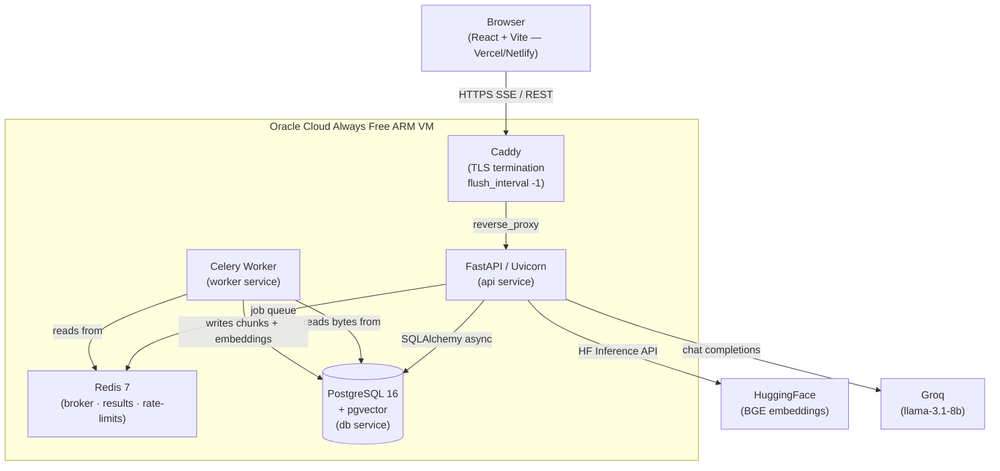

# RAG Document Intelligence Platform

> **Live demo** → _[add your Vercel URL here after deployment]_
>
> **API** → _[add your Caddy domain here]_

<!-- Screenshot / GIF placeholder — replace with actual recording -->
> 

---

## Architecture



---

## Key Engineering Decisions

| Decision | Rationale |
|----------|-----------|
| **Hybrid retrieval + RRF** | pgvector cosine search misses exact terms; PostgreSQL FTS misses semantics. Reciprocal-rank fusion captures both with zero extra infra. |
| **Cross-encoder reranking** | BGE embeddings optimise recall. The cross-encoder (`ms-marco-MiniLM-L6-v2`) re-scores the top-32 candidates for precision. Kill-switch (`RERANKING_ENABLED=false`) saves ~400 MB RAM on tight hosts. |
| **Corrective RAG (LangGraph)** | Grounding score below threshold triggers a focused query rewrite and one retry. Bounded to 2 attempts — no infinite loops. |
| **Table analytics** | pdfplumber extracts Markdown tables at ingest. At query time, pandas computes exact sum/avg/min/max — no LLM arithmetic. |
| **Durable ingestion** | Files stored as `bytea` in PostgreSQL so the Celery worker (separate container) can fetch them without a shared filesystem. |
| **SSE streaming** | `StreamingResponse` + `X-Accel-Buffering: no` ensures Caddy flushes each token immediately. `flush_interval -1` in Caddyfile enforces this end-to-end. |
| **Oracle Cloud Always Free** | 4 OCPU / 24 GB ARM VM hosts the stack. `scripts/keepalive.sh` performs periodic system audits; PAYG account upgrade permanently prevents idle VM reclamation at $0/mo. |
| **Demo mode** | `DEMO_MODE=true` exposes `POST /auth/demo` — no credentials needed for recruiter demos. `DEMO_MODE=false` (default) makes the endpoint 404. Daily upload caps and `scripts/cleanup_demo_uploads.py` prevent disk accumulation. |

---

## Highlights

- **Async FastAPI** + **Celery/Redis** background ingestion with job polling  
- **PDF** extraction with PyMuPDF, **table** extraction with pdfplumber, **OCR** fallback via Tesseract  
- **Hybrid retrieval** — pgvector + PostgreSQL FTS fused with Reciprocal Rank Fusion  
- **Corrective RAG** — LangGraph workflow: route → retrieve → grade → rewrite → retry (≤ 2×)  
- **Table analytics** — exact sum/avg/min/max over extracted Markdown tables via pandas  
- **Streaming answers** — SSE token stream, rendered live as Markdown with clickable `[S1]` citations  
- **Retrieval Inspector** — live view of vector hits, lexical hits, fusion, rerank scores, rewrites  
- **JWT auth** + **Google OAuth 2.0** + shared demo account  
- **Per-user daily caps** on uploads and questions (Redis-backed, configurable)  
- **React + TypeScript** frontend — Vite, TanStack Query, React Router, retro design system  

---

## Run Locally

### Backend

```bash
# Prerequisites: Python 3.12+, PostgreSQL + pgvector, Redis, (optional) Tesseract

cp .env.example .env
# Fill in DATABASE_URL, REDIS_URL, SECRET_KEY, HF_TOKEN, GROQ_API_KEY

python -m venv .venv
.venv\Scripts\activate          # Windows
# source .venv/bin/activate     # Linux/macOS

pip install -r requirements.txt
alembic upgrade head
uvicorn app.main:app --reload
```

Run the Celery worker (in a separate terminal):

```bash
celery -A app.workers.celery_app worker --pool=solo --loglevel=info
```

### Frontend

```bash
cd frontend
cp .env.example .env.local      # VITE_API_BASE=http://127.0.0.1:8000
npm install
npm run dev                     # → http://localhost:5173
```

### With Docker Compose (full local stack)

```bash
docker compose up -d
```

---

## API Reference

| Endpoint | Method | Auth | Description |
|----------|--------|------|-------------|
| `/health` | GET | — | Liveness probe |
| `/ready` | GET | — | DB + Redis readiness |
| `/auth/signup` | POST | — | Email/password registration |
| `/auth/token` | POST | — | JWT via OAuth2 password grant |
| `/auth/google/login` | GET | — | Begin Google OAuth |
| `/auth/google/callback` | GET | — | Complete Google OAuth |
| `/auth/demo` | POST | — | Demo JWT (`DEMO_MODE=true` only) |
| `/documents/upload` | POST | ✓ | Upload PDF/TXT/MD |
| `/documents/` | GET | ✓ | List documents |
| `/jobs/{id}` | GET | ✓ | Poll ingestion job |
| `/questions/analyze` | POST | ✓ | Table analytics + retrieval trace |
| `/questions/stream` | POST | ✓ | Streaming grounded answer (SSE) |

---

## Project Structure

```
app/
  routers/       auth, documents, jobs, questions
  services/      retrieval, reranking, ingestion, analytics, storage, users
  workers/       Celery app + document ingestion task
  models/        User, Document, Page, Chunk, Job, StoredFile
  schemas/       API contracts (incl. RetrievalTrace, AnalyzeResponse)
  middleware/    IP rate-limit, security headers
  core/          config, database, security, dependencies

src/rag/         (future: shared retrieval primitives)
alembic/         PostgreSQL migrations (pgvector, Google identity)
scripts/         seed_demo.py, keepalive.sh, cleanup_demo_uploads.py, create_sample_pdfs.py
samples/         Sample PDFs (text architecture guide + financial table)
tests/           pytest: system, auth, phase1 (demo, rate-caps, trace, CORS)

frontend/
  src/
    api/         Typed API client (client.ts)
    hooks/       useSSE, useHealth
    pages/       LandingPage, DocumentsPage, ChatPage
    components/
      ui/        AppShell, ServerWakeUp
      chat/      CitationPanel
      inspector/ RetrievalInspector
    test/        client, useSSE, CitationPanel unit tests
  e2e/           Playwright end-to-end smoke test
  vite.config.ts
  tailwind / index.css  (retro cream/yellow/black theme)

docs/
  DEPLOY_ORACLE.md    Oracle Cloud ARM VM setup
  DEPLOY_FRONTEND.md  Vercel / Netlify deployment

docker-compose.yml          Local dev (api + worker + redis + db)
docker-compose.prod.yml     Production (+ caddy + migrate one-shot)
Dockerfile                  Multi-stage, linux/arm64, non-root
Caddyfile                   HTTPS + SSE-safe flush_interval -1
.env.example
.env.production.example
```

---

## Deployment

See [`docs/DEPLOY_ORACLE.md`](docs/DEPLOY_ORACLE.md) for the full Oracle Cloud step-by-step.  
See [`docs/DEPLOY_FRONTEND.md`](docs/DEPLOY_FRONTEND.md) for Vercel / Netlify.

---

## Security

- Secrets never committed — only `.env.example` and `.env.production.example` are in Git  
- Production refuses to start with placeholder `SECRET_KEY`, missing API keys, or incomplete OAuth config  
- Google OAuth state stored in Redis with 10-minute expiry, consumed exactly once  
- Per-user daily upload and question caps via Redis counters with 24-hour TTL  
- Non-root container user, no host ports exposed except through Caddy  
