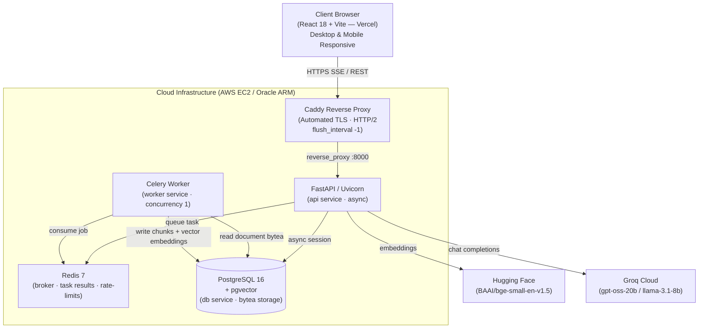

# RAG Document Intelligence Platform

> 🚀 **Live Demo:** [https://rag-intel.vercel.app](https://rag-intel.vercel.app)  
> ⚡ **API Documentation:** [https://rag-intel.duckdns.org/docs](https://rag-intel.duckdns.org/docs)

Production-grade, end-to-end Retrieval-Augmented Generation (RAG) platform with hybrid vector/lexical retrieval, corrective RAG routing via LangGraph, deterministic table analytics, streaming token delivery via Server-Sent Events (SSE), and complete document lifecycle management.

---

## Architecture



---

## Key Engineering Decisions

| Decision | Rationale |
|----------|-----------|
| **Hybrid Retrieval + RRF** | Dense cosine search (`pgvector`) misses exact part numbers or acronyms; lexical search (PostgreSQL `tsvector`) misses semantics. Reciprocal Rank Fusion (RRF) combines both rankings with zero extra external search infrastructure. |
| **Cross-Encoder Reranking** | Dense embeddings optimize initial candidate recall (top-32). A cross-encoder (`ms-marco-MiniLM-L6-v2`) scores query-passage interactions directly for high-precision final ranking (top-8). |
| **Corrective RAG (LangGraph)** | Grounding score below threshold triggers a query reformulation step and targeted retry (bounded to 2 attempts, preventing infinite loops). |
| **Deterministic Table Analytics** | Markdown tables are extracted at ingestion via `pdfplumber`. For quantitative queries, `pandas` computes exact sums, averages, and extremes directly—eliminating LLM arithmetic hallucinations. |
| **Durable Ingestion & Storage** | Uploaded documents are stored durably via a database-backed object storage pattern, enabling decoupled Celery workers to retrieve and process files without shared volumes. |
| **Unbuffered SSE Streaming** | `StreamingResponse` with `X-Accel-Buffering: no` and Caddy's `flush_interval -1` guarantees per-token streaming directly to the browser without reverse-proxy buffering. |
| **Document Lifecycle & Deletion** | Added cascading deletion (`DELETE /documents/{id}`) that cleans up object storage, chunks, pages, and jobs simultaneously. |
| **Zero-Reload Ingestion Tracking** | Real-time polling with automatic cache invalidation transitions completed documents straight to ready-to-chat without requiring manual page refreshes. |
| **Demo Mode & Google OAuth** | `DEMO_MODE=true` provisions isolated demo sessions with pre-seeded documents. Full Google OAuth 2.0 authentication is supported for production users. |

---

## Features

- **Asynchronous Ingestion Pipeline:** Celery + Redis worker with task progress polling and OCR fallback via Tesseract.
- **Hybrid Search Engine:** `pgvector` HNSW index combined with PostgreSQL English `tsvector` and Reciprocal Rank Fusion ($k=60$).
- **Corrective Agentic Flow:** LangGraph state machine (route $\rightarrow$ retrieve $\rightarrow$ grade $\rightarrow$ rewrite $\rightarrow$ generate).
- **Live Retrieval Inspector:** Real-time observability dashboard displaying vector hits, keyword hits, fusion ranks, rerank scores, and query rewrites.
- **Source Citations:** Live markdown answer streaming with clickable `[S1]` citations showing page numbers and source metadata.
- **Retro Design System:** Custom neo-brutalist / retro typography and color palette, fully responsive across desktop, tablet, and mobile devices with collapsible navigation.
- **Production Security:** Non-root Docker containers, Redis-backed sliding-window rate limiting, and strict CORS policies.

---

## API Reference

| Endpoint | Method | Auth | Description |
|----------|--------|------|-------------|
| `/health` | GET | — | Liveness probe |
| `/ready` | GET | — | Database and Redis readiness probe |
| `/auth/signup` | POST | — | User registration |
| `/auth/token` | POST | — | OAuth2 password bearer token |
| `/auth/google/login` | GET | — | Google OAuth 2.0 authorization redirect |
| `/auth/google/callback`| GET | — | Google OAuth callback handler |
| `/auth/demo` | POST | — | Ephemeral demo session JWT (`DEMO_MODE=true`) |
| `/documents/` | GET | ✓ | List user documents with pagination |
| `/documents/upload` | POST | ✓ | Upload document (PDF, TXT, MD up to 10MB) |
| `/documents/{id}` | GET | ✓ | Retrieve document details |
| `/documents/{id}` | DELETE | ✓ | Delete document, chunks, and storage |
| `/jobs/{id}` | GET | ✓ | Poll ingestion job status and progress |
| `/questions/analyze` | POST | ✓ | Quantitative table analytics + retrieval trace |
| `/questions/stream` | POST | ✓ | Server-Sent Events (SSE) streaming answers |

---

## Local Development

### 1. Backend

```bash
# Prerequisites: Python 3.12+, PostgreSQL with pgvector, Redis

cp .env.example .env
# Configure DATABASE_URL, REDIS_URL, SECRET_KEY, HF_TOKEN, GROQ_API_KEY

python -m venv .venv
# Windows:
.venv\Scripts\activate
# Linux/macOS:
# source .venv/bin/activate

pip install -r requirements.txt
alembic upgrade head
uvicorn app.main:app --reload --port 8000
```

Start the Celery worker in a separate terminal:
```bash
celery -A app.workers.celery_app worker --loglevel=info
```

### 2. Frontend

```bash
cd frontend
cp .env.example .env.local  # Set VITE_API_BASE=http://localhost:8000
npm install
npm run dev                 # Accessible at http://localhost:5173
```

### 3. Docker Compose (Full Stack)

```bash
docker compose up -d
```

---

## Testing

```bash
# Run backend tests
pytest tests/ -v

# Run frontend tests
cd frontend
npm test
npm run build
```

---

## License

This project is licensed under the MIT License.
